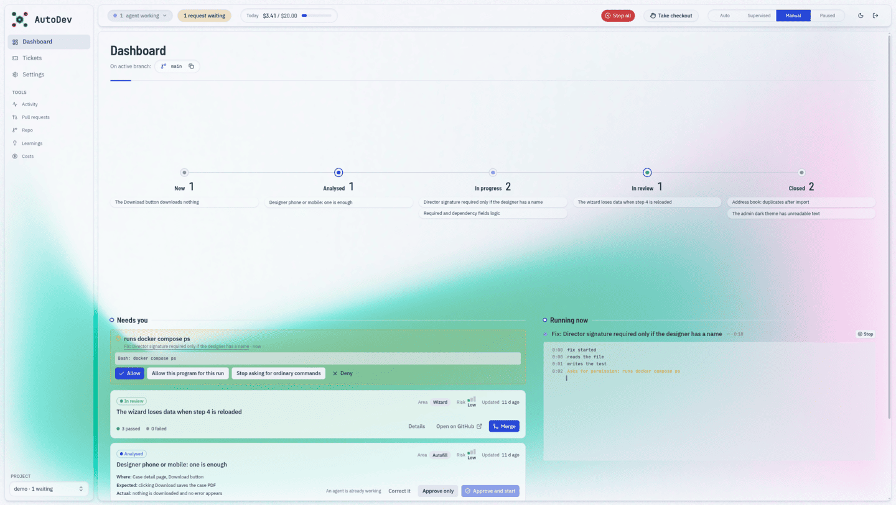
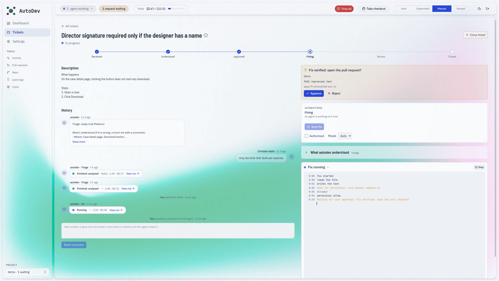
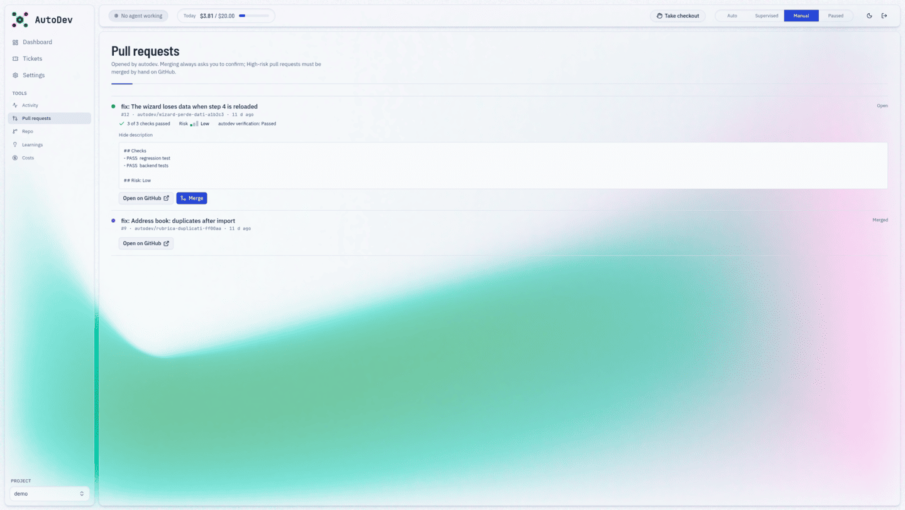
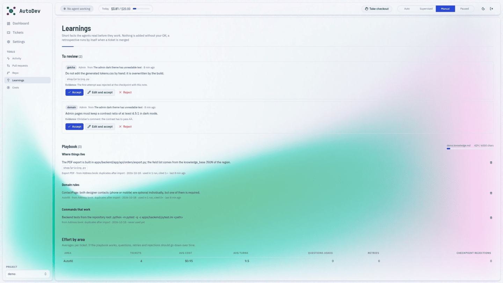
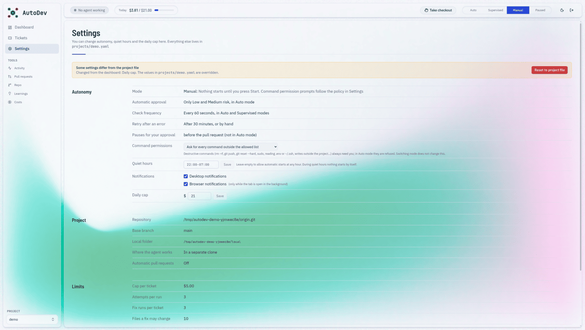
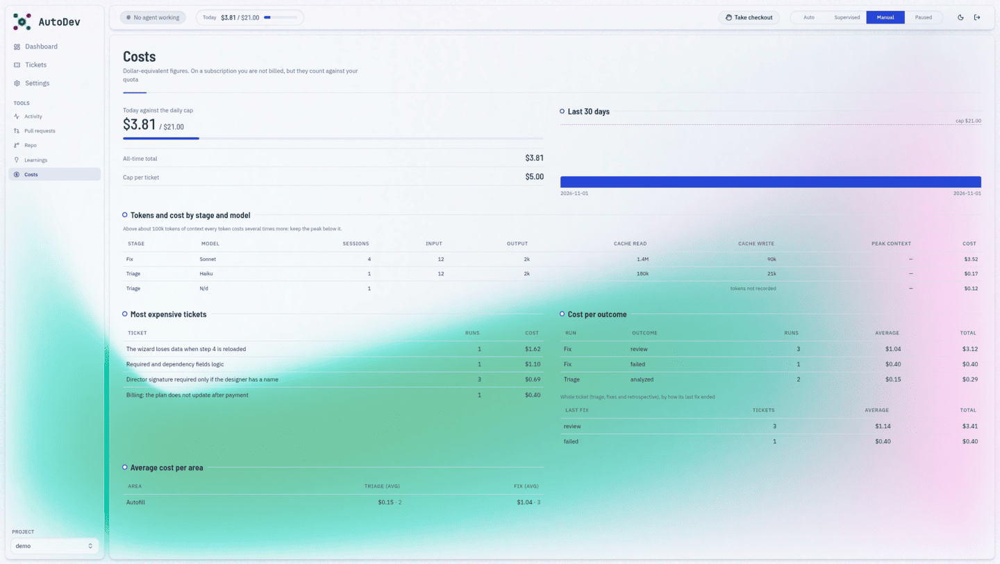
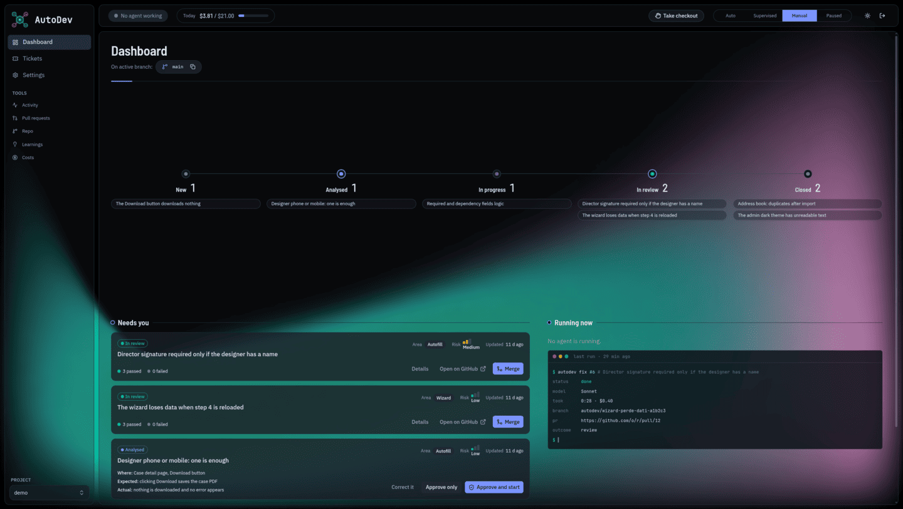

# autodev

Orchestrator that turns tracker tickets (Notion) into verified pull requests using Claude agents. Project-agnostic by design: each target repo is described by a file in `projects/`.

Start from `projects/example.yaml.dist`; `projects/sandbox.yaml.dist` is a toy project for cheap trials.



<details>
<summary>More screenshots</summary>








</details>

## Requirements

Python 3.12+ with [uv](https://docs.astral.sh/uv/), Node 20+ (dashboard), `git`, a Notion integration, optionally a GitHub token, and access to Claude through the Claude Agent SDK.

> **Warning:** agents run code, tests and `git` on your checkout and can push branches and open PRs with your tokens. Start with `projects/sandbox.yaml.dist`, keep the mode on Manual until you trust it, and never expose the dashboard beyond localhost.

## Setup

1. `cp .env.example .env` and fill in `NOTION_TOKEN` (an internal integration shared with the ticket database) and, for pull requests, `GITHUB_TOKEN`.
2. Create the ticket database in Notion with **exactly** the columns below (names are case-sensitive; rename any of them with `tracker.properties` in the project YAML, see [docs/CONFIG.md](docs/CONFIG.md)). Share the database with the integration.

| Column | Type | Filled by |
|---|---|---|
| Title | Title | you |
| Status | Status (options in `tracker.status_map`) | you / autodev |
| Type | Select | you |
| Area | Select (values match the project's `area_map`) | you |
| Priority | Select | you |
| Environment | Select | you |
| Page URL | URL | you |
| Reported by | Text | you |
| Attachments | Files | you |
| Authorized | Checkbox: autodev ignores tickets until it is ticked | you |
| Model | Select: `Auto` or a key of `model_choices` | you |
| Attempts | Number | autodev |
| Cost (USD) | Number | autodev |
| Risk | Select: `Low`, `Medium`, `High` | autodev |
| Branch | Text | autodev |
| PR | URL | autodev |
| Agent notes | Text | autodev |
| Verification result | Select | autodev |

The setup wizard builds this database for you and names the columns autodev fills in `autodev · Risk`, `autodev · Branch`, and so on, so it is clear which are not yours (Notion has no read-only columns); it writes those names under `tracker.properties` in the project file. If you create the database by hand, the plain names above work as they are.

   The ticket description is the page body; people answer questions as page comments.
3. Put the Notion `database_id` / `data_source_id` and the status labels in `projects/<name>.yaml`.
4. Start the dashboard: `GET /api/setup-check` verifies the connection and the columns (a setup wizard will replace this).

## Dashboard and autonomy

`cd dashboard && npm install && npm run build`, then `uv run autodev` (127.0.0.1:8765, password set on first visit). From the top bar you choose how much autodev does alone:

| Mode | Behaviour |
|---|---|
| Auto | Triages authorized tickets, approves analysed ones whose risk is in `autonomy.auto_approve_risks`, then fixes them |
| Supervised | Triages and fixes by itself, but you approve the move to "In progress" |
| Manual | Nothing starts until you press Start on a ticket (default, `autonomy.default_mode`) |
| Paused | Nothing starts; "Stop all" interrupts running agents |

"My turn" holds the checkout: no agent starts while you work in it. One agent runs at a time. Tickets can be authorized, approved, retried, closed, given a model and commented on from the dashboard; every decision is logged as made by you or by the automatic mode. A ticket whose run failed is not retried automatically for `autonomy.retry_cooldown_seconds`.

### Talking to the agents

Runs started from the dashboard are interactive:
- **Message:** writing to a running agent interrupts what it is doing and gives it your text as the next turn, keeping its whole context. **Pause** interrupts and waits for your next message.
- **Permissions:** `autonomy.permission_policy` (also in Settings, where **Reset to project file** brings back the values of the YAML; see [docs/CONFIG.md](docs/CONFIG.md)) is `ask` (every command outside `allowed_bash` waits for you) or `trusted` (ordinary commands run; destructive ones such as `rm -rf`, `git push`, `sudo`, `.env`/`~/.ssh` access and writes outside the project always wait, and are refused in Auto mode). Switching between Manual and Supervised does not change this. A waiting request shows up under "Needs your attention": allow once, allow this program for the run (never a destructive use), stop asking for ordinary commands, or deny with a reason the agent reads.
- **Checkpoints** (`autonomy.checkpoints`, not applied in Auto): `after_agent` waits after the agent says it is done and before the verification gate; `before_pr` waits after verification and before the push and the pull request. Rejecting escalates the ticket.
- Finished runs cannot be resumed with a chat yet.

### The playbook (Learnings)

- Each project has `projects/<name>.knowledge.md`: short entries in four categories (`where` things live, `domain` rules people decided, `gotcha`s, `command`s that work), each with its source ticket, date, optional area and paths. The triage and fix agents receive the relevant ones (by the ticket's Area and by paths, within `knowledge.max_chars`); triage must check the playbook before asking a question and cites the entries it used in its comment.
- When a PR is merged, a cheap read-only **retrospective** run (kind `learn`, in Activity) reads the ticket, the human answers, the checkpoint rejections, the changed files and the effort, and **proposes** entries. Nothing enters the playbook until you press Accept on the **Learnings** page (or Edit and accept); paths that do not exist in the checkout are flagged. "Learn from this ticket" runs it on demand.
- The page also shows the current playbook (with how often each entry was used and cited, and Delete) and per-area effort: tickets, average cost and turns, questions asked, retries and checkpoint rejections. Configure it under `knowledge:` ([docs/CONFIG.md](docs/CONFIG.md)).

### Repo and pull requests

- **Repo:** the checkout's state, the agent branches with a file-by-file diff, "Try" (switch to a branch to test it with Docker), "Back to <base>", and **Run the checks** (the project's `checks` as a tracked run). Switching branches and deleting are refused while an agent works or when the tree is dirty.
- **Pull request:** autodev's PRs with GitHub check status, the ticket's risk and verification, and the PR description with the evidence. **Merge** (squash) needs a second click and is refused for drafts, failing or pending checks, conflicts and High risk; a merge closes the ticket and deletes the remote branch.
- Branches whose PR was merged (even squashed) count as merged. The Repo page deletes them (also on GitHub) and removes leftover clones in `workspaces/`; unmerged branches are never removed.

### Running unattended

- **Quiet hours** (`autonomy.quiet_hours: "22:00-07:00"`, editable in Settings): nothing starts by itself in that window; a manual Start still works.
- **Notifications:** a desktop notification (via `notify-send`, or `autonomy.notify_command` with `{title}` and `{body}`) when a request or checkpoint waits for you, a run finishes or fails, the daily cap is reached or a PR is merged. The browser tab title shows the number of pending requests, and optional browser notifications work while the tab is open in the background.
- **Housekeeping:** every polling round a merged PR closes its ticket and a PR closed unmerged escalates it (`autonomy.auto_cleanup_branches: true` also deletes the merged local branch).
- **Costs:** every agent session records its tokens (input, output, cache read/write), cost, turns and tool calls; the Costs page breaks them down by stage and model, area and outcome. Agents run without the Claude account's MCP connectors and personal memory (`agents.*.user_mcp`), which had been ~2/3 of the spend. See [docs/COSTS.md](docs/COSTS.md).
- **Several projects:** `uv run autodev` serves every file in `projects/` (or the ones named with `--project`, repeatable). A project switcher appears in the sidebar; mode, daily cap, quiet hours, runs and costs are per project, and each project's agent works on its own checkout.

### Measuring triage

`src/autodev/evals.py` replays triage on tickets already fixed and scores it (verdict, recall and precision of `suspected_files` against the files the fix changed, cost, turns), so a prompt change is judged on numbers. It no longer has a command; a dashboard page is planned (see [docs/BACKLOG.md](docs/BACKLOG.md)).

## Layout

```
src/autodev/   orchestrator (trackers, agents, sandbox, pipeline, github, knowledge playbook, report)
e2e/           demo server with fake data for UI work and screenshots
dashboard/     React + Vite web UI, built to static files served by `autodev`
tests/         pytest suite (fixtures in tests/fixtures)
projects/      per-project configuration (your own files are git-ignored)
docs/          design notes, Notion schema
```

## Roadmap

Done: Notion integration and triage agent, fix agent in an isolated worktree that opens the PR, verification gate, dashboard with autonomy modes, playbook and evals.

Next: Playwright verification on local/staging, a review agent, auto-merge for low-risk classes, other trackers than Notion. See [docs/BACKLOG.md](docs/BACKLOG.md).

See [docs/NOTION_SCHEMA.md](docs/NOTION_SCHEMA.md) for the ticket database and state machine.

## License

[FSL-1.1-ALv2](LICENSE) (Functional Source License, converting to Apache 2.0). You can use, modify and self-host autodev for any purpose except offering it as a competing product or service; each version becomes Apache 2.0 two years after its release. This is source-available, not an OSI open source license.
